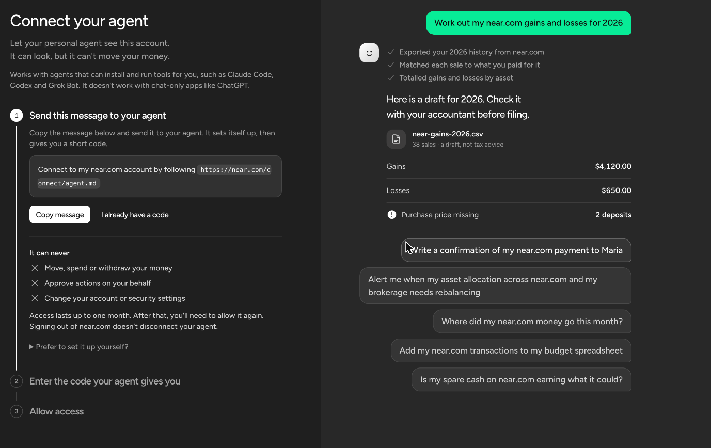
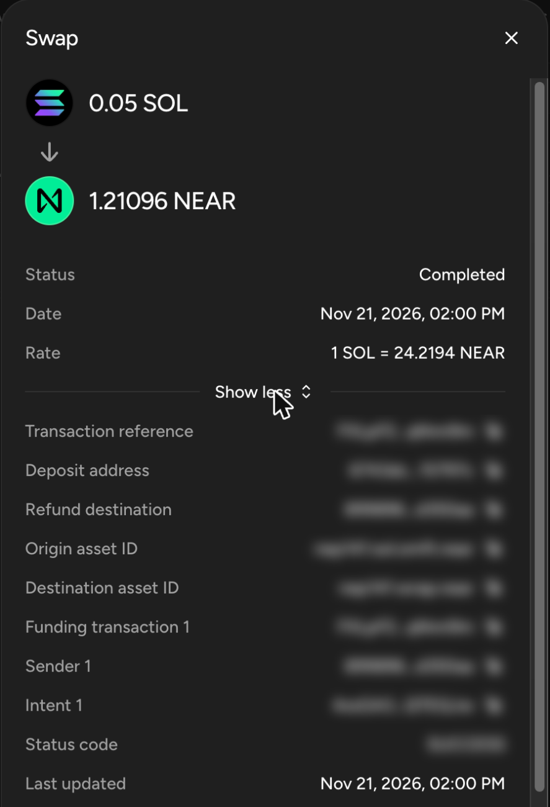
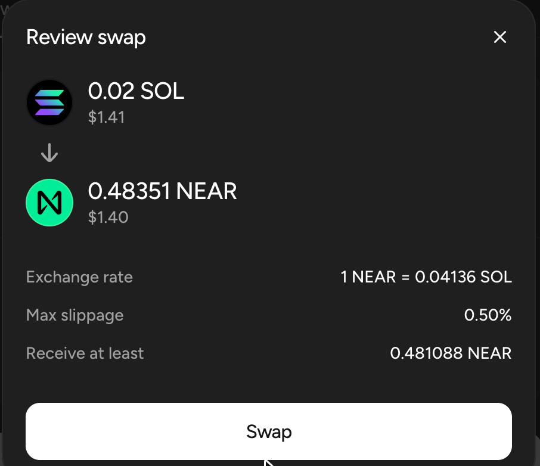
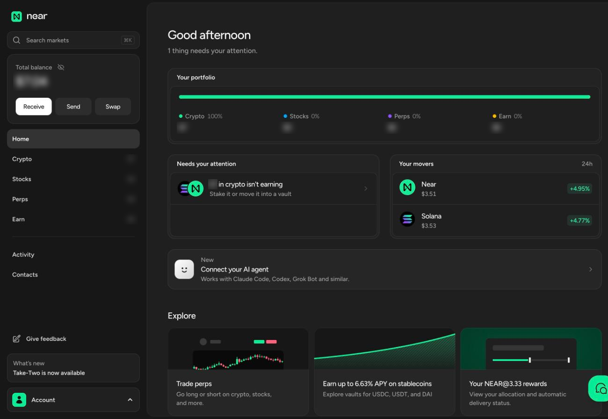
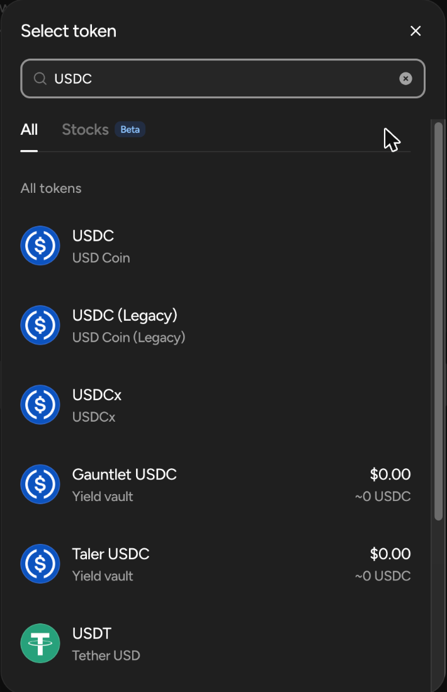

# Private to the world. Readable by your agent.

Narrative arc for near.com · November 2026

## The story

AI agents are starting to manage money for people, but to do it well, an agent needs to see everything: your balances, history, positions and contacts. Onchain, that same information is visible to anyone who looks.

near.com can be the account that resolves this. Your agent reads all of it. The public sees none of it.

That's the story I intend to build for near.com. It turns confidential by default from a privacy setting into the reason agents and people should both keep their money here.

The timing helps. In 2025, a run of kidnappings in France targeted crypto founders and their families, and Coinbase disclosed that bribed support staff had leaked customer data to scammers. Both point the same way. Once people know what you hold, you become a target.

## It's already true

- **Confidential by default.** Confidential has been the default on near.com since late August, according to NEAR co-founder Illia Polosukhin. Balances, deposits, swaps and payments are hidden from public view.
- **Agents can read the account.** Connect your agent gives Claude Code, Codex and similar agents read-only access. The page puts it plainly: "It can look, but it can't move your money."
- **One account across 37 chains.** An agent reads one place instead of a wallet on every chain.

No exchange, wallet or fintech app I know of can do all 3 today.

## Where your agent's data goes

When you connect a third-party agent, it reads your confidential history and sends it to that AI provider. The chain keeps your activity private, but the agent's provider still sees it.

near.com already has the missing piece. The homepage says NEAR AI models "run in secure environments so your information is never exposed," not even to near.com. It also lists "Understand your finances with AI" as coming soon.

Combined, near.com can make a promise that's hard to copy. Your agent reads everything, and nobody else sees it, including the public chain and the company that runs the agent, like Anthropic for Claude Code or OpenAI for Codex. I'd build the launch around that promise. It depends on NEAR AI's roadmap, so it's the first thing I'd confirm.

## Why it isn't landing yet

From a funded first session (1 cross-chain swap):

1. **The privacy is invisible.** Nothing in the swap flow or Activity says a transaction was confidential. The help center's "Confidential mode" article still tells users to find a toggle the app no longer shows.
2. **The agent page doesn't say what the agent sees.** The setup file lists "balances, history, contacts and Earn positions." The page you read before connecting lists none of it, and doesn't mention where that data goes.
3. **The best demo is buried.** The page's example, an agent drafting "my near.com gains and losses for 2026," is the most persuasive thing in the product, but it sits on a setup screen.

## 90 days to make the story land

**Weeks 1 to 4: make it visible.** Show confidential status on the review screen and every Activity item. Add an "It can see" list to the agent page, with a plain line about AI providers. Fix the help center. Measure agent connections per 100 funded accounts.

**Weeks 4 to 10: launch the story.** "Private to the world. Readable by your agent." Time the tax demo for filing season, when people want it most. Brief 10 to 15 creators who build with agents, and publish a 60-second walkthrough of connecting one. Measure agent connections and funded accounts from the launch.

**Weeks 10 to 12: close the loop.** Position NEAR AI private inference as the agent for people who don't want their financial history going to any AI company. Use the same promise in co-marketing for NEAR Intents partner launches. Measure the share of agent users who choose private inference once it ships.

**What I'd ask in week 1.** What share of sign-ups fund within 24 hours? How many funded accounts have connected an agent? When does "Understand your finances with AI" ship? I'd set the 90-day targets from those answers.

# Copy for the launch

First drafts to react to. I wrote them from the product as it works today, without knowing your roadmap.

**1. Launch line**
> Private to the world. Readable by your agent.

**2. Agent page, a new "It can see" list next to "It can never"**
> It can see: your balances, history, contacts and Earn positions.
> What your agent reads is shared with your AI provider, under their privacy terms.

The second line can look like it scares users off. Privacy buyers will find out anyway, and they'll trust it more coming from near.com.

**3. Review screen**
> Confidential. The amounts and assets in this swap are hidden from the public chain. [confirm wording with the product team]

**4. Tax campaign post**
> Your agent can do the worst part of crypto tax season now.
>
> Connect it to near.com. Ask for your 2026 gains and losses.
>
> It matches every sale on near.com to what you paid and hands you a CSV for your tax tool.
>
> It can look. It can't move your money.
>
> A draft, not tax advice.

# Appendix: evidence from my first session

**Scope.** One user in Canada, where stocks and perps are blocked. Solana wallet sign-in, a small SOL deposit, 0.05 SOL swapped to NEAR. Every section of the app, plus the Connect your agent page and its setup file.

## A. Confidential by default is invisible

The review screen, the progress screen and Activity never mention confidentiality. The only reference in the flow is a support-ticket field, "Account scope: Confidential history," behind "Need help with this transaction?"

The help center's "Confidential mode" article, listed among its most popular, still says to find "the Confidential mode toggle in the sidebar" and describes separate Main and Confidential balances. The app has no toggle. The homepage line "confidential when you want them to" still describes it as optional.

## B. The agent page

The best page in the app. The "It can never" list is specific, access expires after a month, and setup is one message to paste into your agent. 2 gaps:

1. **What the agent can see.** The setup file (connect/agent.md) says the agent can read "balances, history, contacts and Earn positions." The page itself never lists it.
2. **What setup does.** The agent installs @defuse-protocol/nearcom-cli and writes a password file to the user's computer. The page doesn't say so. A disconnect link next to "Signing out of near.com doesn't disconnect your agent" would also help.

The example output flags "Purchase price missing" for deposits from outside near.com. A tax campaign should promise near.com gains and losses, ready to import into a tax tool.

## C. The swap is better than the screen says

My 0.05 SOL swap filled above its quote, 1.21096 NEAR against 1.21002, and the app didn't mention it.

The review screen shows the rate, slippage and minimum received, with no cost line. The USD values give the cost away anyway. On my swap they put it at about 0.6%, or $0.60 on a $100 swap.

## D. Blocked products lead the home screen

After funding, the home screen still promotes "Trade perps," and the What's new banner says "Take-Two is now available." Both are blocked in Canada, and the block only shows after opening a market. The app already applies a region at the point of trade, so the home screen can use it too.

## E. Smaller things

- "USDC (Legacy)" appears in search with no explanation. Legacy assets come from addresses used before confidential became the default.
- The default transaction view shows Status, Date and Rate, and leaves out the networks, USD values, cost, time and confidential status.
- Settings defaults "eligible USD" to the Taler USDC vault, marked Promo, with no explanation.
- The Solana deposit option is tagged "Delayed" with no reason. A short line with the expected wait would stop users from guessing.
- Send has a "Use max" button. Swap only fills the max when you click the balance figure, which is easy to miss. If that's deliberate, to leave room for fees or prevent accidental full-balance swaps, a short label would say so.
